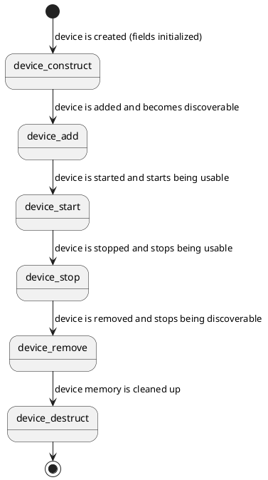

# Device

A device generally relates to a specific piece of hardware. A [driver](kernel-concepts/driver.md) is bound to it to make it usable.
There can also more abstract instances of devices that help facilitate other devices.

```c
/** Represents a piece of hardware */
struct Device {
    int32_t address;
    const char* name;
    const void* config;
    struct Device* parent;
    device_flags_t flags;
    struct DeviceInternal* internal;
}
```

A device has a name for debugging/logging purposes.
It has an optional `config`, and an `address` that can represent an index, a memory address, or some other kind of offset.

`flags` is a bitmask of `DEVICE_FLAG_*` (`tactility/device.h`): `DEVICE_FLAG_DTS` (instantiated from a `.dts` file), `DEVICE_FLAG_DYNAMIC` (dynamically allocated), `DEVICE_FLAG_VIRTUAL` (no physical hardware), `DEVICE_FLAG_REMOVABLE` (may disappear, e.g. USB/SDIO), `DEVICE_FLAG_HOTPLUG` (supports hotplug).

For example:

```c
static struct Device i2c_internal = {
	.name = "i2c_internal",
	.config = &i2c_internal_config,
	.parent = &root,
	.internal = NULL
};
```

Devices are part of a devicetree. This tree starts with a root node and all devices are attached to it.
This means that all devices have a parent, except for the root node itself. More on that in [Devicetree](kernel-concepts/devicetree.md).

So its lifecycle is as follows:



The code could look like this:

```c
// Find the driver
struct Driver* driver = driver_find_compatible("espressif,esp32-i2c");

check(device_construct(&i2c_internal) == ERROR_NONE);
device_set_driver(&i2c_internal, driver);
check(device_add(&i2c_internal) == ERROR_NONE);
check(device_start(&i2c_internal) == ERROR_NONE);

// The device is now usable

check(device_stop(&i2c_internal) == ERROR_NONE);
check(device_remove(&i2c_internal) == ERROR_NONE);
check(device_denstruct(&i2c_internal) == ERROR_NONE);
```

## Referencing a device safely

Looking up a device only returns a pointer - nothing stops another thread from calling `device_stop()` on it right after, freeing the driver's private data before you get a chance to use it.

For any lookup that isn't immediately followed by a single, same-thread use, take a reference instead of a bare pointer:

```c
Device* device;
if (device_get_by_name("i2c_internal", &device) == ERROR_NONE) {
    // device is guaranteed valid and started until device_put()
    some_api_call(device);
    device_put(device);
}
```

`device_get_by_name()` (and `device_get_first_by_type()`, `device_get_first_active_by_type()`, `device_get_first_by_compatible()`) look up and reference a device atomically, so a device that's concurrently torn down is either not found or safely referenced - never a dangling pointer. While any reference is outstanding, `device_stop()` fails fast with `ERROR_RESOURCE_BUSY` instead of tearing down the driver's data underneath you.

If you already hold a trusted `Device*` (e.g. a static devicetree pointer captured once at bind time) and just need to bracket a single operation, use the lower-level pair directly:

```c
if (device_get(device) == ERROR_NONE) {
    some_api_call(device);
    device_put(device);
}
```

## Devicetree

Devices are usually defined in a device's `.dts` file, which the build turns into `struct Device` instances. See [Devicetree](kernel-concepts/devicetree.md).
