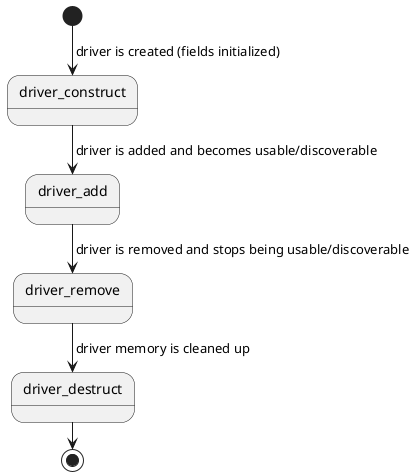

# Driver

A driver contains the code for a type of hardware, like an I2C controller or a display panel. Drivers bind to [devices](kernel-concepts/device.md), and are registered by [modules](kernel-concepts/module.md).

## Driver definition

Drivers are defined by `struct Driver` in `tactility/driver.h`:

```c
struct Driver {
    const char* name;
    const char** compatible;
    error_t (*start_device)(struct Device* dev);
    error_t (*stop_device)(struct Device* dev);
    error_t (*probe)(struct Device* device);
    const void* api;
    const struct DeviceType* device_type;
    const struct Module* owner;
    struct DriverInternal* internal;
};
```

For example:

```c
Driver esp32_i2c_master_driver = {
    .name = "esp32_i2c_master",
    .compatible = (const char*[]) { "espressif,esp32-i2c-master", nullptr },
    .start_device = start,
    .stop_device = stop,
    .api = &ESP32_I2C_MASTER_API,
    .device_type = &I2C_CONTROLLER_TYPE,
    .owner = &platform_esp32_module,
    .internal = nullptr,
};
```

| Field | Purpose |
|---|---|
| `name` | The driver's name, for logging and debugging |
| `compatible` | A `NULL`-terminated list of the `compatible` strings this driver supports (see [Binding to devices](#binding-to-devices)) |
| `start_device` | Starts a device: sets up the hardware and allocates the driver's data for it |
| `stop_device` | Stops a device: releases everything that `start_device` set up |
| `probe` | Optional: reports whether the hardware is present (see [Hotplug](#hotplug)). `NULL` means it's always present |
| `api` | The functions of the driver's device type, e.g. a `DisplayApi` or an `I2cControllerApi` |
| `device_type` | The type of the devices this driver creates (e.g. `&I2C_CONTROLLER_TYPE`), so that they can be found by type |
| `owner` | The module that owns the driver. When it's `NULL`, the system owns the driver and it can't be removed |
| `internal` | The kernel's internal state. Initialize it to `NULL`, and don't touch it |

Fields that aren't used can be left out of the initializer, so they're `NULL`.

## Starting and stopping devices

`start_device` is called when a device that uses this driver is started. It typically:
1. Reads the device's configuration from the devicetree (`device->config`, cast to the driver's config struct).
2. Acquires what the device needs: GPIO pins, a bus, memory, a task.
3. Initializes the hardware.
4. Stores its own state with `device_set_driver_data()`, so the API functions can find it with `device_get_driver_data()`.

When anything fails, it releases what it already acquired, and returns an error. The device then isn't started.

`stop_device` undoes all of it, in reverse order. The kernel only calls it when nothing holds a reference to the device: `device_stop()` fails with `ERROR_RESOURCE_BUSY` while references are outstanding.

## Binding to devices

The `compatible` strings connect drivers to devices: a device in the devicetree names its `compatible` driver, and the driver's YAML binding describes the properties that device can set. When a device is added, the kernel finds the driver with a matching `compatible` string (`driver_find_compatible()`) and binds it. See [Devicetree](kernel-concepts/devicetree.md).

## Hotplug

Some hardware can be connected and disconnected while the system runs, like a detachable keyboard or an SD card. Its driver implements `probe`, which checks whether the hardware is present (e.g. by reading a register or a "card detect" pin), and returns `ERROR_NONE` when it is.

The kernel calls `probe` regularly, and starts or stops the device when its presence changes (`device_hotplug_poll_once()`). Such devices get `DEVICE_FLAG_HOTPLUG`. Other parts of the system check whether such a device is usable with `device_is_ready()`.

`probe` must be quick, and must not add or remove devices.

## SPI and other shared buses

A driver whose device is on a bus that other devices share, such as SPI, must lock the bus around its operations. See [SPI Controller](driver-development/spi-controller.md).

## Lifecycle



Modules usually do this for you: list the drivers in the module's `drivers` array, and `module_start()`/`module_stop()` construct, add, remove and destruct them (see [Module](kernel-concepts/module.md)).

## Writing drivers

The [Driver Development](driver-development/display.md) section describes specific types of drivers: [Display](driver-development/display.md), [IO Expander](driver-development/io-expander.md), [Keyboard](driver-development/keyboard.md), [Pointer](driver-development/pointer.md) and [SPI Controller](driver-development/spi-controller.md).
