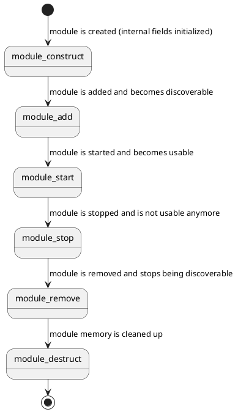

# Module

A module is a collection of [drivers](kernel-concepts/driver.md) or other functionality that can be loaded and unloaded at runtime. Modules can also export symbols for apps (see [Symbols](app-development/symbols.md)).

```c
struct Module {
    const char* name;
    error_t (*start)(void);
    error_t (*stop)(void);
    struct Driver* const* drivers;
    const struct ModuleSymbol* symbols;
    struct ModuleInternal* internal;
};
```

There are many types of modules:
- Platform modules: Found in `Platforms/`. These contain platform drivers and optionally initialization code for the platform.
- Device modules: Found in `Devices/`. These contain device-specific drivers and optionally initialization code for a device.
- Other modules: Modules that contain specific features are found in `Modules/` (e.g. LVGL)

`drivers` is an optional NULL-terminated array of driver pointers. `module_start()` calls `driver_construct_add()` on each in order; `module_stop()` calls `driver_remove_destruct()` on each in reverse order. This is the preferred way to register a module's drivers - only reach for manual `driver_construct_add()`/`driver_remove_destruct()` calls inside `start`/`stop` for drivers that need conditional or dynamic setup.

For example:

```c
Driver* const platform_esp32_drivers[] = {
    &esp32_gpio_driver,
    &esp32_i2c_driver,
    NULL
};

struct Module platform_module = {
    .name = "platform-esp32",
    .start = NULL,
    .stop = NULL,
    .drivers = platform_esp32_drivers,
    .symbols = NULL,
    .internal = NULL
};
```

The lifecycle is as follows:



Example:

```c
// Allocate memory (creates internal data)
check(module_construct(&hal_device_module) == ERROR_NONE);
// Register the module
check(module_add(&hal_device_module) == ERROR_NONE);
// Activate the module
check(module_start(&hal_device_module) == ERROR_NONE);

// The module is now active

// Stop the module. This can fail when the module is in use (see below)
check(module_stop(&hal_device_module) == ERROR_NONE);
// Deregister the module
check(module_remove(&hal_device_module) == ERROR_NONE);
// Deallocate memory (destroys internal data)
check(module_destruct(&hal_device_module) == ERROR_NONE);
```

## Resolving symbols

`module_resolve_symbol()` looks up a symbol in the `symbols` table of one module. `module_resolve_symbol_global()` looks in all modules. Both work for a module that was added with `module_add()`, also when it hasn't started yet. This is what lets the modules and apps of an [app package](app-development/modules.md), that load early during boot, find the symbols of firmware modules that are added already but start later. A module that isn't added yet, like `lvgl-module` at that moment, can't be found.

Calling a function of a module that hasn't started is up to the caller: its code is there, but its state isn't set up yet.

## References

A reference keeps a module from being stopped, removed or destructed. It matters for modules that are loaded at runtime, the [modules from an app package](app-development/modules.md): their binary is unloaded when the package is uninstalled, and code that still points into it would crash. Hold a reference for as long as you use the functions or data of such a module.

Built-in modules are linked into the firmware, so their code is always in memory. Code that calls their functions directly doesn't need a reference. They can still be stopped, and it is up to the code that stops them to deal with their users (for example, the Terminal app stops LVGL on purpose).

`module_get()` takes a reference on a started module and `module_put()` releases it. `module_resolve_symbol_global_get()` resolves a symbol and takes the reference in the same step, so the module can't stop in between.

The ELF loader of the ESP32 takes one reference on every module whose symbols an app or a package module uses, built-in modules included, and releases them when that binary is unloaded. So a built-in module can't be stopped while a loaded binary uses its functions. You only call `module_get()` and `module_put()` yourself when you look up functions at runtime, like an app that must start without the module it needs.

`module_stop()` returns `ERROR_RESOURCE_BUSY` and leaves the module running when:
- something holds a reference on it, also when the module hasn't started, or
- one of its [drivers](kernel-concepts/driver.md) is bound to a device.

The check and the refusal of new references or binds are one atomic step. Nothing can use the module in between, and a refused stop doesn't leave a driver removed.

A module that hasn't started, or has stopped, is still added, so its symbols can still be resolved and referenced. `module_remove()` therefore also returns `ERROR_RESOURCE_BUSY` while a reference is held, and the module stays added. `module_ensure_destructed()` fails with the same error.

## Modules from packages

A [package](app-development/modules.md) can contain modules. They are marked as external, which `module_is_external()` returns. `module_set_external()` sets the flag on a constructed module, until it is destructed. The modules of the firmware are never external.
