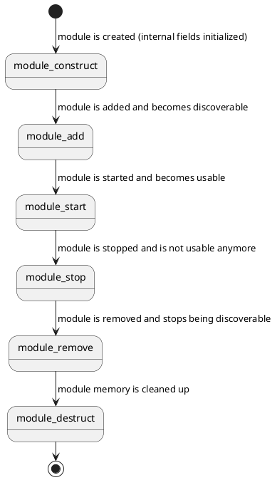

# Module

A module is a collection of [drivers](kernel-concepts/driver.md) or other functionality that can be loaded and unloaded at runtime. Modules can also export symbols for apps (see [Symbols](app-development/symbols.md)).

```c
struct Module {
    const char* name;
    error_t (*start)(void);
    error_t (*stop)(void);
    struct Driver* const* drivers;
    const struct ModuleSymbol* symbols;
    struct ModuleInternal* internal;
};
```

There are many types of modules:
- Platform modules: Found in `Platforms/`. These contain platform drivers and optionally initialization code for the platform.
- Device modules: Found in `Devices/`. These contain device-specific drivers and optionally initialization code for a device.
- Other modules: Modules that contain specific features are found in `Modules/` (e.g. LVGL)

`drivers` is an optional NULL-terminated array of driver pointers. `module_start()` calls `driver_construct_add()` on each in order; `module_stop()` calls `driver_remove_destruct()` on each in reverse order. This is the preferred way to register a module's drivers - only reach for manual `driver_construct_add()`/`driver_remove_destruct()` calls inside `start`/`stop` for drivers that need conditional or dynamic setup.

For example:

```c
Driver* const platform_esp32_drivers[] = {
    &esp32_gpio_driver,
    &esp32_i2c_driver,
    NULL
};

struct Module platform_module = {
    .name = "platform-esp32",
    .start = NULL,
    .stop = NULL,
    .drivers = platform_esp32_drivers,
    .symbols = NULL,
    .internal = NULL
};
```

The lifecycle is as follows:



Example:

```c
// Allocate memory (creates internal data)
check(module_construct(&hal_device_module) == ERROR_NONE);
// Register the module
check(module_add(&hal_device_module) == ERROR_NONE);
// Activate the module
check(module_start(&hal_device_module) == ERROR_NONE);

// The module is now active

// Stop the module
check(module_stop(&hal_device_module) == ERROR_NONE);
// Deregister the module
check(module_remove(&hal_device_module) == ERROR_NONE);
// Deallocate memory (destroys internal data)
check(module_destruct(&hal_device_module) == ERROR_NONE);
```
